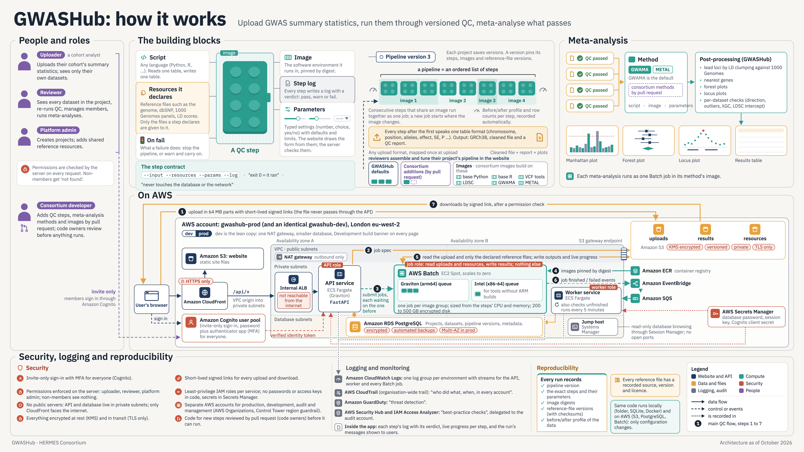
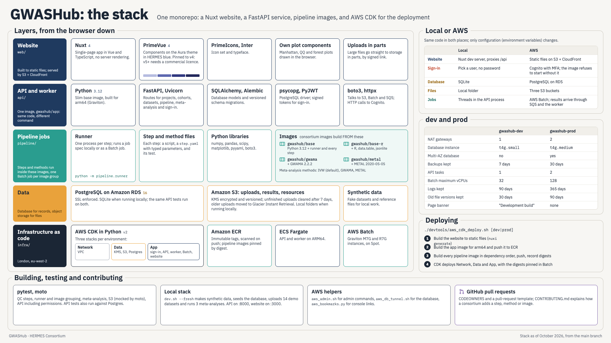

# GWASHub

Upload GWAS summary statistics, QC them with a transparent, reproducible pipeline, review the
results, and meta-analyse across cohorts. A HERMES Consortium resource.

The same code runs **locally** (synthetic data, SQLite, a local folder for files, jobs in threads,
pick-a-user sign-in) and **on AWS** (S3, Postgres, AWS Batch, Cognito sign-in with MFA, CloudFront).





| Doc | What's in it |
|---|---|
| `docs/PROGRESS.md` | What's built, test results, decisions taken, known gaps |
| `docs/AWS_FULL.md` | **The AWS deployment as built**: what runs where, deploying, admin commands, where to look in the console |
| `CONTRIBUTING.md` | How a consortium adds its own QC step, meta-analysis method (and image) by pull request |
| `docs/AWS_DEPLOYMENT.md` | The design and reasoning behind the AWS setup (production checklist, costs) |
| `docs/AWS_ACCOUNT_SETUP.md` | Step-by-step guide to the AWS Organization and accounts |

## Quick start (local)

```bash
./devtools/dev.sh --fresh   # first time: venv, pipeline images, synthetic data, seeded DB, 14 demo uploads, 3 meta-analyses
./devtools/dev.sh           # afterwards
```

QC steps run in their Docker images locally too (`GWASHUB_STEP_RUNNER=docker`): the default pipeline needs R,
bcftools, gwas2vcf and LDSC, which live in the images. `dev.sh` builds any image that's missing
(`./devtools/build_images.sh`, about 15 minutes the first time; the two x86-64 images build under emulation on Apple silicon).

Open http://localhost:3000 and sign in as any listed user (local mode has no passwords):

| User | HERMES 3 | HCM |
|---|---|---|
| demo@gwashub.org (platform admin) | reviewer | uploader |
| ama@example.org | reviewer | – |
| jonas@example.org, mei@example.org | uploader | – |
| tom@example.org | – | reviewer |
| noor@example.org | – | uploader |

Uploaders open only their own datasets; reviewers see everything in the project, review QC, run
meta-analyses and manage the pipeline and members; platform admins can also create projects.

## Layout

```
web/                 frontend: Nuxt 4 SPA (PrimeVue 4); /api proxied to :8000 in dev
api/                 backend: FastAPI app (gwashub_api), Alembic migrations (api/migrations), tests
pipeline/            compute that runs as jobs
  runner/              runs a pipeline (one process per step); jobspec.py runs a job spec locally or as a
                       Batch job (aws/batch_entry.py)
  qc_steps/            QC steps by owner: gwashub/ (defaults), <consortium>/ (added by pull request);
                       one folder per step (script, step.yaml, test_<step>.py); shared _lib/, templates/
  images/              images steps and methods run in, by owner: gwashub/base (Python), gwashub/base-r (R),
                       gwashub/vcf (bcftools + gwas2vcf), gwashub/ldsc (bulik/ldsc), gwashub/gwama, gwashub/metal
                       (the programs, built from pinned, checksummed releases)
  analyses/            meta_analysis/<owner>/<method>/ (analysis.yaml + script): gwashub/gwama (default),
                       gwashub/metal, custom_example/custom_meta_analysis; shared _metalib/
  tests/               runner, image grouping, meta-analysis, S3 tests
resources/           reference files: catalog.yaml (where each comes from), build/*.sh (download + build), README.md
images/app/          the site image (API and worker)
infra/               AWS CDK app: Network, Data and App stacks (docs/AWS_FULL.md)
devtools/            dev.sh, build_images.sh, synth.py (synthetic data), seed.py, e2e.py, run_demo.py; AWS: aws_cdk_deploy.sh,
                     aws_admin.sh, aws_db_tunnel.sh, aws_bookmarks.py
docs/                progress, AWS guides, architecture image prompt
local/               git-ignored: synthetic/ (fake data + resources), app/ (dev DB, uploads, runs), runs/
```

## Tests

```bash
./devtools/build_images.sh     # once (tests that need an image skip without it)
.venv/bin/python -m pytest      # QC steps, runner and grouping, meta-analysis, S3 (mocked), API incl. permissions
GWASHUB_TEST_DB_URL=postgresql+psycopg://user:pw@localhost:5432/db .venv/bin/python -m pytest api/tests/test_api.py   # same API tests on Postgres
```

## The step contract

Every step (default or consortium, any language) is called as

```
<command> --input working.tsv --resources DIR --params params.json --log step_log.json
```

and writes `{"verdict": "pass|warn|fail", "metrics": {}, "messages": [], "artifacts": []}` to `--log`.
It may rewrite `--input` in place, keeping the GWASHub format (`chr pos ea oa beta se p` + optional
`eaf n ncase ncontrol rsid info`); only the first step, `gwashub/parse`, reads the upload as received. Extra files go in `$GWASHUB_ARTIFACT_DIR`; other optional context:
`GWASHUB_STEP_LOGS`, `GWASHUB_RUN_DIR`. Exit 0 = it ran; non-zero = crashed. See `CONTRIBUTING.md`.
